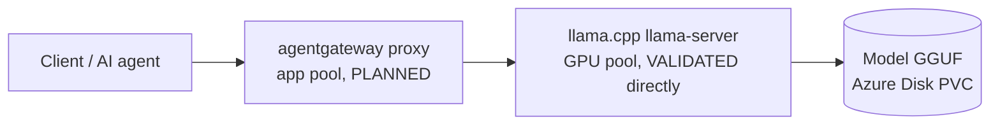

# Architecture

Status (2026-10-20): AKS, the Spot GPU pool, the NVIDIA device plugin and llama.cpp are DEPLOYED and VALIDATED (see [STATUS.md](../STATUS.md)). agentgateway is PLANNED. Labels: FACT, DECISION, ASSUMPTION, HYPOTHESIS, OPEN QUESTION.

## Request path (DECISION)

- Client -> agentgateway: HTTP through a Gateway API `Gateway` (GatewayClass `agentgateway`). First tests use `kubectl port-forward`; no public LoadBalancer unless a decision is recorded.
- agentgateway -> llama.cpp: `AgentgatewayBackend` with the `openai` provider pointing at `llama-cpp.llm.svc.cluster.local:8080`, plus an `HTTPRoute` (D-006). FACT: llama-server answers `POST /v1/chat/completions` and `GET /v1/models` (Phase 7).
- llama.cpp is exposed as a ClusterIP Service only (no LoadBalancer, NodePort or Ingress; Tester-confirmed). FACT: no NetworkPolicy exists in `llm`, so any pod in the cluster can reach it.

## Azure / AKS layout (DEPLOYED)

| Component | Choice | Basis |
|---|---|---|
| IaC | `infra/main.bicep` + `scripts/up.sh|down.sh|status.sh|preflight.sh` | D-002 |
| Region | southeastasia | D-005 |
| Cluster | AKS Standard `aks-agw-lab`, Kubernetes 1.36, resource group `rg-aks-agw-lab`, Azure CNI overlay, system-assigned identity | D-007 |
| `system` pool | `Standard_D2s_v5` x1, taint `CriticalAddonsOnly` | keeps user workloads off |
| `app` pool | `Standard_D4s_v5` x1, label `workload=app` | agentgateway and helpers |
| `gpunp` pool | `Standard_NC72ds_xl_RTXPRO6000BSE_v6` x1, **Spot**, zone 1, 128 GB managed OS disk, taints `sku=gpu:NoSchedule` and `kubernetes.azure.com/scalesetpriority=spot:NoSchedule`, label `workload=gpu-inference` | D-003, D-008, T-006 |

## GPU (VALIDATED)

- FACT: the SKU is a MIG slice of an RTX PRO 6000 Blackwell Server Edition: `nvidia-smi` shows MIG mode Enabled and one MIG device of ~46 GiB. Driver 595.91.07, CUDA 13.x.
- FACT: AKS default GPU profile installs the driver only (`gpuProfile.driver=Install`). We deploy the NVIDIA device plugin v0.18.0 (`k8s/gpu/nvidia-device-plugin.yaml`) with `MIG_STRATEGY=single`; it must run `privileged` (T-007). The node then advertises `nvidia.com/gpu: 1`.
- FACT: GPU pods need nodeSelector `workload=gpu-inference`, both tolerations, and `nvidia.com/gpu: 1`. A pod without these does not land on the GPU node; a second GPU pod stays Pending (one GPU unit).
- FACT: this SKU defaults to a 2040 GB ephemeral OS disk that breaks node bootstrap; the pool uses a 128 GB managed disk (T-006).
- Spot: the node can be evicted at any time (D-008). Standard GPU quota is unavailable (T-005).

## llama.cpp (router mode, four models; single-model path VALIDATED earlier)

- `k8s/llm/llama-cpp.yaml`: namespace `llm`, PVC `llama-models` (64 GiB `managed-csi-premium`, RWO), ConfigMap `llama-models-preset`, Deployment `llama-cpp` (strategy `Recreate`, image pinned by digest, router mode: `--models-preset /config/models.ini --models-max 3 -ngl 99 -c 8192`, `LLAMA_CACHE=/models`), ClusterIP Service `llama-cpp:8080` (D-009, D-010, D-011).
- Models (request `model` = preset name): `qwen2.5-7b-instruct`, `qwen2.5-coder-7b-instruct`, `llama-3.1-8b-instruct`, `phi-4`, all Q4_K_M from ungated bartowski repos. Each loads on first use and is cached on the PVC; the router unloads the least recently used model beyond 3.
- FACT (Developer, in-cluster test): all four models answered a deterministic question correctly (`42`); first load 26-72 s each (includes download); generation 49-81 tokens/s. The Qwen2.5 7B was unloaded when Phi-4 loaded (LRU).
- FACT (Tester, single-model version, earlier): ~95-97 tokens/s, PVC persistence (pod replaced in 12 s without re-download). The router-mode change has NOT yet had an independent Tester pass.
- FACT: a real Spot eviction occurred (~15 h after the node was created) and recovery was automatic: new node via the autoscaler, device plugin and GPU resource re-appeared, PVC re-attached, all four models loaded from the PVC cache without re-download, inference correct. Downtime was roughly 25-30 minutes (T-008).
- Not yet tested: agentgateway path; independent Tester pass on the router-mode version.
- Security note: the router logs "router mode enabled - do not expose to untrusted environments" and "no API key set and CORS allows all origins"; its API also has model download/delete endpoints. Keep it ClusterIP/localhost-only; revisit in Phase 11.

## agentgateway (PLANNED)

FACT from the official install guide (v1.6.0):

1. Gateway API CRDs v1.6.0 (standard channel).
2. `helm upgrade -i agentgateway-crds oci://cr.agentgateway.dev/charts/agentgateway-crds --version v1.6.0 -n agentgateway-system --create-namespace`.
3. `helm upgrade -i agentgateway oci://cr.agentgateway.dev/charts/agentgateway --version v1.6.0 -n agentgateway-system`.
4. A `Gateway` with `gatewayClassName: agentgateway`.

Place the proxy on the `app` pool. Pin versions. Gateway validation requires a real client -> agentgateway -> llama.cpp -> model request.

## Security posture (current)

- No public exposure of llama.cpp or any service; the AKS API server is public with local accounts enabled (D-007).
- The device plugin runs privileged (T-007); Azure Policy emits admission warnings, not denials (T-004).
- No secrets in the repo; parameter files with real values are gitignored.
- Security Reviewer pass scheduled at Phase 11, and before any external exposure.
