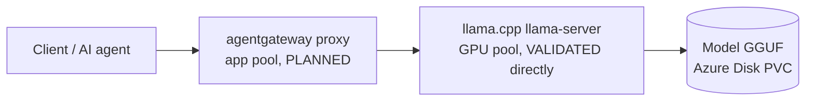

# Architecture

Status (2026-10-20): AKS, the Spot GPU pool, the NVIDIA device plugin and llama.cpp are DEPLOYED and VALIDATED (see [STATUS.md](../STATUS.md)). agentgateway is PLANNED. Labels: FACT, DECISION, ASSUMPTION, HYPOTHESIS, OPEN QUESTION.

## Request path (DECISION)



- Client -> agentgateway: HTTP through a Gateway API `Gateway` (GatewayClass `agentgateway`). First tests use `kubectl port-forward`; no public LoadBalancer unless a decision is recorded.
- agentgateway -> llama.cpp: `AgentgatewayBackend` with the `openai` provider pointing at `llama-cpp.llm.svc.cluster.local:8080`, plus an `HTTPRoute` (D-006). FACT: llama-server answers `POST /v1/chat/completions` and `GET /v1/models` (Phase 7).
- llama.cpp is exposed as a ClusterIP Service only (no LoadBalancer, NodePort or Ingress; Tester-confirmed). FACT: no NetworkPolicy exists in `llm`, so any pod in the cluster can reach it.

## Azure / AKS layout (DEPLOYED)

| Component | Choice | Basis |
|---|---|---|
| IaC | `infra/main.bicep` + `scripts/up.sh|down.sh|status.sh|preflight.sh` | D-002 |
| Region | southeastasia | D-005 |
| Cluster | AKS Standard `aks-agw-lab`, Kubernetes 1.36, resource group `rg-aks-agw-lab`, Azure CNI overlay, system-assigned identity | D-007 |
| `system` pool | `Standard_D2s_v5` x1, taint `CriticalAddonsOnly` | keeps user workloads off |
| `app` pool | `Standard_D4s_v5` x1, label `workload=app` | agentgateway and helpers |
| `gpunp` pool | `Standard_NC72ds_xl_RTXPRO6000BSE_v6` x1, **Spot**, zone 1, 128 GB managed OS disk, taints `sku=gpu:NoSchedule` and `kubernetes.azure.com/scalesetpriority=spot:NoSchedule`, label `workload=gpu-inference` | D-003, D-008, T-006 |

## GPU (VALIDATED)

- FACT: the SKU is a MIG slice of an RTX PRO 6000 Blackwell Server Edition: `nvidia-smi` shows MIG mode Enabled and one MIG device of ~46 GiB. Driver 595.91.07, CUDA 13.x.
- FACT: AKS default GPU profile installs the driver only (`gpuProfile.driver=Install`). We deploy the NVIDIA device plugin v0.18.0 (`k8s/gpu/nvidia-device-plugin.yaml`) with `MIG_STRATEGY=single`; it must run `privileged` (T-007). The node then advertises `nvidia.com/gpu: 1`.
- FACT: GPU pods need nodeSelector `workload=gpu-inference`, both tolerations, and `nvidia.com/gpu: 1`. A pod without these does not land on the GPU node; a second GPU pod stays Pending (one GPU unit).
- FACT: this SKU defaults to a 2040 GB ephemeral OS disk that breaks node bootstrap; the pool uses a 128 GB managed disk (T-006).
- Spot: the node can be evicted at any time (D-008). Standard GPU quota is unavailable (T-005).

### Why Kubernetes needs the NVIDIA device plugin

On a standalone machine, such as the ThinkPad running llama.cpp in Docker,
the NVIDIA driver and NVIDIA Container Toolkit can provide GPU access without
a Kubernetes device plugin. For example, `docker run --gpus all ...` explicitly
requests GPU access for that container; no Kubernetes scheduler is involved.

| Component | Responsibility |
|---|---|
| NVIDIA driver | Lets the operating system communicate with the GPU. |
| `nvidia-smi` | Reports GPU status, memory usage, driver details, and processes. It is a diagnostic tool, not a Kubernetes resource allocator. |
| NVIDIA Container Toolkit | Integrates GPU device and NVIDIA library access with the container runtime. |
| NVIDIA device plugin | Discovers GPU devices, registers them with kubelet, reports their availability, and participates in allocating them to containers. |

Kubelet is the Kubernetes agent on each worker node. The plugin registers GPU
resources with kubelet so the scheduler can account for them. Our llama.cpp
pod requests one GPU resource through its container limits:

```yaml
resources:
  limits:
    nvidia.com/gpu: 1
```

The scheduler selects a node with an available GPU resource; kubelet and the
plugin coordinate device allocation, and the configured container runtime
provides GPU access. A working `nvidia-smi` on a node does not prove that
Kubernetes can allocate its GPU. In this lab, the driver worked before the
plugin was deployed, but the node did not advertise `nvidia.com/gpu` (T-007).

Our node exposes a MIG (Multi-Instance GPU) partition: a hardware-isolated
portion of a physical GPU with about 46 GiB of GPU memory. With
`MIG_STRATEGY=single`, the plugin advertises this partition as one
`nvidia.com/gpu` resource. Here, requesting `1` means one exposed MIG
partition, not an entire physical GPU. It also does not mean one model:
llama.cpp manages several models inside the pod holding that allocation.

The plugin runs as a DaemonSet targeting the GPU node label, with both GPU
and Spot tolerations. Kubernetes starts a plugin pod on a matching replacement
node after Spot eviction. The plugin does not install the driver, load model
weights, or run inference. Its privileged configuration is a lab-specific
requirement observed during testing (T-007), not a universal requirement for
all NVIDIA device plugin deployments.

In short: the driver makes the GPU usable by the machine; the Container
Toolkit makes it accessible to containers; the device plugin makes it
allocatable through Kubernetes.

## llama.cpp (router mode, four models; single-model path VALIDATED earlier)

- `k8s/llm/llama-cpp.yaml`: namespace `llm`, PVC `llama-models` (64 GiB `managed-csi-premium`, RWO), ConfigMap `llama-models-preset`, Deployment `llama-cpp` (strategy `Recreate`, image pinned by digest, router mode: `--models-preset /config/models.ini --models-max 3 -ngl 99 -c 8192`, `LLAMA_CACHE=/models`), ClusterIP Service `llama-cpp:8080` (D-009, D-010, D-011).
- Models (request `model` = preset name): `qwen2.5-7b-instruct`, `qwen2.5-coder-7b-instruct`, `llama-3.1-8b-instruct`, `phi-4`, all Q4_K_M from ungated bartowski repos. Each loads on first use and is cached on the PVC; the router unloads the least recently used model beyond 3.
- FACT (Developer, in-cluster test): all four models answered a deterministic question correctly (`42`); first load 26-72 s each (includes download); generation 49-81 tokens/s. The Qwen2.5 7B was unloaded when Phi-4 loaded (LRU).
- FACT (Tester, single-model version, earlier): ~95-97 tokens/s, PVC persistence (pod replaced in 12 s without re-download). The router-mode change has NOT yet had an independent Tester pass.
- FACT: a real Spot eviction occurred (~15 h after the node was created) and recovery was automatic: new node via the autoscaler, device plugin and GPU resource re-appeared, PVC re-attached, all four models loaded from the PVC cache without re-download, inference correct. Downtime was roughly 25-30 minutes (T-008).
- Not yet tested: agentgateway path; independent Tester pass on the router-mode version.
- Security note: the router logs "router mode enabled - do not expose to untrusted environments" and "no API key set and CORS allows all origins"; its API also has model download/delete endpoints. Keep it ClusterIP/localhost-only; revisit in Phase 11.

## agentgateway (PLANNED)

FACT from the official install guide (v1.6.0):

1. Gateway API CRDs v1.6.0 (standard channel).
2. `helm upgrade -i agentgateway-crds oci://cr.agentgateway.dev/charts/agentgateway-crds --version v1.6.0 -n agentgateway-system --create-namespace`.
3. `helm upgrade -i agentgateway oci://cr.agentgateway.dev/charts/agentgateway --version v1.6.0 -n agentgateway-system`.
4. A `Gateway` with `gatewayClassName: agentgateway`.

Place the proxy on the `app` pool. Pin versions. Gateway validation requires a real client -> agentgateway -> llama.cpp -> model request.

### MCP connectivity concepts (reference, not deployed)

The intended experiments include MCP servers running as pods behind internal
Services, and third-party MCP servers reached over HTTPS. These are future
possibilities, not deployed or validated paths. The gateway proxies requests;
the agent application still discovers tools, supplies tool definitions to the
model, executes requested tool calls, and returns results to the model.
Routing model and MCP traffic through one gateway does not automatically give
llama.cpp the ability to call MCP tools.

#### First lab MCP server: two-tool LOCAL source VALIDATED

Human requirements (2026-10-21): Python, lab-information tools, and a learning
and demonstration experience that can be explained to customers and hiring
managers. The code/configuration walkthrough is in [README.md](../README.md).
Architect accepts the D-012 teaching amendment's LOCAL source milestone for
supervised loopback only: independent Tester 63 PASS in 13.95s plus own SDK
HTTP probes, Security Reviewer 63 PASS in 13.90s plus 23 supplemental checks.
Actual SDK calls negotiated `2025-11-25`, discovered/called both tools without
a session ID, preserved the fixed target despite extra arguments and bounded
slow-body observation at 3.006s. Probe/Host/Origin, errors/logs, cleanup and offline
checks passed. Evidence: [agent-execution-log.md](agent-execution-log.md).
This supersedes historical three-tool/54-test acceptance for current source,
not the former guard's response-protection guarantees. README's twelve-minute
code agenda is proposed, not measured or delivered; Kubernetes/gateway is a
separate later 10-15 minute discussion. No live upstream or gateway proof follows.
The MCP component is now DEPLOYED under D-014 with Developer implementation
evidence for actual AMD64 execution, immutable registry delivery, Kubernetes
runtime and live upstream health. Independent Tester now confirms these paths
and 63 source tests; Security Reviewer gives bounded GO. Architect ACCEPTS D-014
as VALIDATED for this MCP milestone only; gateway validation remains pending.
D-014 governs the trusted supervised single-operator MCP MVP on
existing `aks-agw-lab`, including the previously approved dedicated lab registry only.
Gateway installation, public exposure, unrelated infrastructure and silent RBAC
expansion remain outside scope; design approval is not runtime acceptance.

- Exactly two argument-free tools: `get_lab_overview` includes static context and configured presets; `get_model_health` observes the fixed upstream. Results are ordinary dictionaries without output-model classes or runtime provenance/readiness metadata.
- Start read-only, without shell execution or Kubernetes API access. A health check must not trigger inference or load a model; configured presets are not proof that models are loaded or healthy.
- Use official `mcp` v1 FastMCP, initially targeting `mcp==1.30.0`, with the existing Python scaffold and a uv lockfile (D-012). This is an explicit maintenance-line choice, not the latest major: current v2 uses `MCPServer`. Verify the installed release; v1 source supports revisions through `2025-11-25`, not assumed `2026-07-28` support.
- Use Streamable HTTP at `/mcp`, one replica on the CPU `app` pool, an internal ClusterIP Service, and separate application health endpoints.
- Use verified v1 `stateless_http=True` and `json_response=True`; acceptance requires a real HTTP SDK client initialize/list/call smoke test, independently of model tool calling. MCP Inspector is optional.
- Overview/presets come from the unchanged shared JSON/ConfigMap shape, not live discovery. Health returns only `status`, `reason`, `http_status`. Healthy requires 200 plus object `status: ok`; loading requires 503 plus `status: loading model`. Other 4xx/5xx are unhealthy; malformed/mismatched expected bodies are unknown. Ignore unrelated JSON fields. One GET has a 3-second overall deadline, 16 KiB streamed cap, no compression/redirects/retries/environment proxies and normal HTTPS verification. No caller-selected target, inference or model administration is possible.
- Local execution defaults to loopback; container binding is explicit. Narrow Host/Origin allowlists and SDK 64 KiB MCP cap remain. Small lifecycle/tool outcomes replace custom telemetry; dependency/access diagnostics are suppressed and Uvicorn proxy-header trust is off. No authentication, TLS, or NetworkPolicy isolation is claimed; broader access requires separate review (D-012).

**Current MVP (D-014, VALIDATED; trusted supervised single-operator lab only):**

- Last recorded AKS settings: `networkPlugin: azure`, `networkPluginMode: overlay`,
  `networkDataplane: azure`, `networkPolicy: none`; refreshed before execution.
  No cluster networking changes were made.
- Deployed: dedicated `mcp` namespace, one CPU app-pool replica, ClusterIP HTTP,
  operator API port-forward explicitly bound to localhost. Other pods CAN reach
  MCP; outbound traffic is NOT network-restricted. Fixed application GET `/health`
  is a tool constraint, not network isolation. Host/Origin checks authenticate
  neither the operator nor pod callers; no application authentication/TLS exists.
- Defer Cilium and NetworkPolicy enforcement for this trusted, supervised,
  single-operator lab. No networking migration/reimage, ineffective policy objects,
  gateway installation or public exposure. This supersedes the immediate D-013
  isolation gate, not its history or future hardening designs.
- Dedicated Basic ACR `acragwlabd18f2ff3` in southeastasia adds cost and is the
  sole approved infrastructure expansion. Isolated `infra/registry.bicep` passed
  compilation/server validation; reviewed what-if created only registry and scoped
  assignment. Traditional `LegacyRegistryPermissions`, admin/anonymous disabled;
  authenticated public registry endpoint, not application exposure. Existing
  operator roles covered create/push and assignment. Only kubelet registry-scoped
  `AcrPull` was added; no operator roles/admin passwords/pull secrets.
  Published and actual pod imageID both equal
  `acragwlabd18f2ff3.azurecr.io/lab-info@sha256:29f6d6d123c54cec36ca64c104ff55450de823a27b52d3a1db75cdfd8e320b76`.
  One Ready replica ran on `aks-app-42647623-vmss000000`, zero restarts.
  Every Kubernetes operation must explicitly
  target `--context=aks-agw-lab`, without relying on the active context. Final
  stored current-context differs from the earlier snapshot; see STATUS.
- Independent Tester confirms runtime, exact deployed image/source, real SDK
  initialize/list/both structured calls, health/probes, invalid Host/Origin
  rejection and failure independence with the same offline image. Security review
  permits only the trusted supervised scope; SDK reflection MEDIUM, unauthenticated
  plaintext/unrestricted internal access and availability LOW remain accepted
  only in this boundary, not fixed. Architect ACCEPT is based on these recorded
  independent reports; no new runtime/cloud checks were performed for acceptance.
  Exact permission, image, runtime and review contract:
  [D-014](decisions.md#d-014-trusted-supervised-mcp-lab-mvp-human-approved-amendment-2026-10-23-planned).
- Developer checks: actual pod x86_64, UID/GID 10001, read-only rootfs, no token,
  zero effective capabilities, NoNewPrivs=1 and seccomp=2. Both probes 200.
  Real SDK via localhost:18000 initialized 2025-11-25, listed/called both tools
  with structured results and no session ID; live fixed health healthy/health_ok/200.
  Local hardened image proved probe independence during upstream failure; live
  upstream was not interrupted. Temporary port-forward closed after checks.
  Curated overview revision 2026-10-22.1 remains static historical teaching data,
  including its deployment disclaimer, not a runtime inventory.

**Future hardening retained (D-013, both phases PLANNED/deferred):**

Phase 1 denies ordinary MCP ingress, uses operator localhost API forwarding and
allows egress only to required DNS and verified llama.cpp pods on TCP 8080.
Phase 2 later adds only verified gateway namespace AND pod-selected ingress to
TCP 8000, retaining other restrictions. Neither authorizes gateway installation.
Before resuming, review supported enforcement/cluster impact, additive policies,
selectors and independent allow/deny tests. NetworkPolicy is L3/L4, not `/health`
filtering, authentication or TLS; DNS, node/kubelet and administrator exceptions
remain. Revisit before sharing/untrusted workloads, wider access or integration.

Implementation map: root `main.py`, curated `config/lab-info.json`, frozen
`uv.lock`, `tests/test_lab_mcp.py`, `Dockerfile`, default-deny `.dockerignore`,
and `k8s/mcp/lab-info.yaml`. Python dependency resolution is restricted to
`https://packagefeedproxy.microsoft.io/pypi/simple`, including container uv
bootstrap. The audited lock uses only that registry and its Microsoft-hosted
artifact links; no public PyPI fallback is allowed. Installed `mcp==1.30.0`
exposes the planned APIs and the real client negotiated `2025-11-25`.
Plain `FastMCP` owns Streamable HTTP without `LabMCP`, `SafeHTTP`, custom envelope
parsing/replay or correlation metadata. Custom probes explicitly call the SDK
request validator; they do no upstream I/O. An unavailable upstream cannot
disable static overview/probes. Extra arguments may be ignored by the SDK but
cannot change the target/action. Unexpected application failures use constant
`ToolError`; unknown names remain SDK errors without executing a tool.

Known MEDIUM residual: SDK malformed-envelope/protocol errors and unknown tool
names can reflect caller input. The old guard's response protection was removed
intentionally for this supervised loopback lesson; log suppression is NOT
equivalent protection. Tests characterize reflection instead of asserting the
old guarantee. Localhost is not per-user authorization. Untrusted/shared access
requires renewed security/exposure design. No agent/gateway tracing is enabled.
Packaging uses the Python 3.12.15 base index digest
`sha256:6a0e06f5ba0b373d051aabd3fffb9b873f27f9a2a3a14bcbe37dee6f0e3bbc70`.
Feed-provided uv 0.11.24 hashes are enforced; native BUILDPLATFORM frozen offline
lock export avoids a reproduced AMD64 uv/QEMU crash. Target-platform pip installs
only hash-verified runtime wheels from the approved feed. Actual AMD64 build/run
and Kubernetes admission/runtime have independent Tester evidence in STATUS.
Residual LOW limitation remains: inbound uploads have no deadline/concurrency
bound. Neither
whole-container provenance nor shared/customer exposure is accepted. Phase 8
remains paused; independent D-011 router validation is still required before
Phase 9 and is not supplied by this MCP milestone.

**Binding versus exposure:** `0.0.0.0:8000` means the Python process accepts
IPv4 connections on the pod's interfaces. It does not allocate a public IP.
A ClusterIP Service provides a stable internal address and forwards traffic
to the pod's listening port, for example:

```text
Client -> agentgateway -> ClusterIP Service:80 -> pod IP:8000 -> /mcp
```

Binding only to `127.0.0.1` would normally prevent Service traffic from
reaching the process. ClusterIP is not authentication or a complete network
boundary: other reachable workloads can call it unless additional controls
restrict access. Initial laptop access should use local port-forwarding,
not a public LoadBalancer.

**Session behavior:** stateful operation remembers protocol/session state
between requests, so restarts can invalidate sessions and multiple replicas
can require session-aware routing or shared state. Stateless operation avoids
depending on an in-memory protocol session and is simpler for independent
read-only calls. It does not remove authentication requirements or mean the
agent loses conversation history; that history belongs to the agent
application. Session behavior is SDK- and protocol-version-dependent; verify
the actual lifecycle rather than inferring it from the HTTP transport alone.

**Kubernetes credentials:** Kubernetes normally mounts a ServiceAccount token
that identifies a pod's application to the Kubernetes API; RBAC controls its
permissions. These tools can read mounted configuration and call llama.cpp's
HTTP endpoint without Kubernetes API credentials. Set
`automountServiceAccountToken: false` (as the llama.cpp pod already does).
This removes an unnecessary credential, not ordinary HTTP connectivity. If
future tools need Kubernetes access, review narrowly scoped RBAC first.

Do not bake tokens, API keys, or kubeconfig files into source or container
images. Supply any future credentials securely at runtime. Read-only tools
can still expose information: review returned data, endpoint access, and
redacted lifecycle telemetry before sharing the lab with others.

#### Stdio versus Streamable HTTP

MCP is a protocol; its transport determines how messages reach the server.

| Transport | How it works | Implication for Kubernetes |
|---|---|---|
| Stdio | A client launches a server process and exchanges protocol messages through its standard input/output streams. | A pod alone does not expose those streams as a network service. |
| Streamable HTTP | A server listens on a network endpoint, commonly `/mcp`. | Clients or the gateway can reach it through a Kubernetes Service. |

Declaring a container port does not make a stdio-only program listen on that
port. A transport adapter can launch the stdio server and bridge MCP messages
between HTTP and the process streams:

```text
Client -> gateway -> HTTP adapter -> stdin/stdout -> MCP server process
```

For network-hosted servers, prefer native Streamable HTTP support where
available. A stdio-only server needs a compatible adapter or another supported
hosting arrangement. Verify transport, authentication, and session behavior
for each backend rather than assuming every MCP server is interchangeable.

#### Phase-by-phase MCP and model events

This is an observability reference, not evidence that logging or tracing is
enabled. Protocol messages and application events are different: tool
discovery and invocation use MCP, while adding tools to model context and
interpreting a model's tool selection happen in the agent application.
"Context injection" here means adding tool definitions or results to a model
request, not a prompt-injection attack.

Record the protocol revision on each gateway leg before choosing expected
events. Revisions through `2025-11-25` use an `initialize` handshake followed
by `notifications/initialized`. Revision `2026-07-28` uses per-request version,
identity, and capability metadata instead, with optional `server/discover`;
it does not require that handshake. A compatible proxy can speak different
revisions to the client and the upstream server. Verify actual SDK and gateway
behavior rather than assuming the two legs have identical messages or IDs.

| Phase | Requests or events to look for | Where to look and what it proves |
|---|---|---|
| 1. Connection and authentication | DNS resolution, TCP connection, TLS handshake for HTTPS, HTTP request to the configured MCP path; authentication challenge or rejection if applicable. | Client transport logs, gateway access/security logs, and upstream connection logs. Reachability is not proof of MCP compatibility. Pooled connections need not reconnect for every call. |
| 2. Initialization or version discovery | Legacy: `initialize` request/response with protocol version, identity and capabilities, then `notifications/initialized` (no JSON-RPC response). Modern: optional `server/discover`, followed by version/capability metadata on requests; unsupported-version errors if incompatible. | Client and MCP-aware gateway/server logs. Distinguish client-to-gateway discovery from gateway-to-backend discovery. Legacy session identifiers may exist; modern requests do not require a protocol session. |
| 3. Tool discovery | `tools/list` request and response containing names, descriptions and `inputSchema`; additional pages when `nextCursor` is returned. | Client discovery logs and gateway/server MCP logs. Record returned tool count and catalog version/hash. Cached discovery may mean no fresh request for a new user turn. |
| 4. Tool definitions added to model context | Agent filters/converts discovered tools into the model API's tool definitions, commonly a `tools` field in `POST /v1/chat/completions`. | Agent context-assembly logs; model-route telemetry if configured. This is an LLM API request, not an MCP message. Record included names/count and schema hash rather than full prompts. |
| 5. Model selection | Model response may contain `tool_calls` with a call ID, tool/function name and arguments, or may answer without a tool. Streaming responses may deliver these incrementally. | Agent/model-response telemetry. A model-selected tool is a proposal, not evidence of execution; tool calling depends on model and serving configuration. |
| 6. Validation and approval | Agent validates arguments, maps the model-facing name to its MCP target, and applies approval/access checks. A rejected or denied proposal produces no `tools/call`. | Agent validation/approval events and configured authorization logs. Record allowed/denied and a safe reason. Gateway policies may also reject a call during forwarding. |
| 7. Tool invocation | Agent sends JSON-RPC `tools/call`, with `params.name` and `params.arguments`, through the MCP route. The gateway forwards to the owning target; virtual MCP may translate a prefixed name. | Client, gateway MCP telemetry, and server tool-handler start event. Record logical target, exposed and upstream tool names, request ID, start time and attempt number. |
| 8. Execution and result | Tool handler may call another API, then returns an MCP result (`content`, optional `structuredContent`, and `isError`) or a JSON-RPC error. Timeouts and transport failures are separate outcomes. | MCP server handler/downstream logs, gateway, and client. HTTP 200 alone does not prove success: inspect JSON-RPC `error` and tool-result `isError`. Downstream API traffic is not automatically gateway traffic. |
| 9. Tool result added to model context | Agent validates/sanitizes the result and sends a follow-up model request; commonly a message with role `tool` and the matching `tool_call_id`. | Agent context-assembly logs and model-route telemetry. This is another LLM API request, not a new MCP method. Treat tool output as untrusted data, not authoritative instructions. |
| 10. Completion or another iteration | Model returns a final answer or requests more tools, repeating phases 5-9. Connections may remain open; closure and cancellation depend on protocol/transport. | Agent turn-completion events and model telemetry. Record final outcome, elapsed time and tool-call count; do not require disconnect events at the end of every turn. |

For virtual MCP, discovery can fan out to several upstream servers. The
gateway may cache catalogs, filter tools through configured policies, and
translate names and protocol versions. One client request is not necessarily
one identical upstream request. Trace both legs to identify which backend
provided a tool and which one executed it.

Suggested correlation fields for future instrumentation (these are not
existing log field names or enabled settings):

- UTC timestamp, component, event/phase, duration, outcome and safe error code.
- Agent run/turn ID, distributed trace/span IDs where propagation is supported, and gateway request ID.
- MCP JSON-RPC request ID scoped to its connection/leg; notifications have no request ID. Track a legacy session only where applicable and avoid logging bearer-like identifiers in plaintext.
- Model tool-call ID and its explicit mapping to the MCP request ID. They are different identifiers and are not automatically correlated by the gateway.
- Route/backend identity, protocol revision, exposed/upstream tool names, catalog/schema hash and attempt number.

Ordinary HTTP access logs may show only `POST /mcp`, status and latency, not
`tools/list` or `tools/call` inside the JSON-RPC body. MCP-aware logging or
application spans are needed for those details; agent instrumentation is
needed for context assembly and selection. Tracing must be explicitly enabled
and verified. Do not assume the gateway's default logs expose all phases.
Log structured metadata by default, not credentials, full prompts, raw tool
arguments/results or sensitive content. Do not enable blanket body logging
to fill an observability gap, or automatically retry side-effecting calls.

Protocol references: [legacy lifecycle (2025-11-25)](https://modelcontextprotocol.io/specification/2025-11-25/basic/lifecycle),
[versioning and compatibility (2026-07-28)](https://modelcontextprotocol.io/specification/2026-07-28/basic/versioning),
and [tools (2026-07-28)](https://modelcontextprotocol.io/specification/2026-07-28/server/tools).

#### Individual endpoints versus virtual MCP

Virtual MCP, also called multiplexing or federation, presents tools from
several upstream MCP servers through one logical MCP endpoint and connection.
It does not combine their programs or move them into a single pod.

```text
Client -> one gateway MCP endpoint
            |-> Documentation MCP server: search_docs
            |-> Deployment MCP server: deployment_status
            |-> Remote incident MCP server: incident_lookup
```

The gateway aggregates tool discovery and forwards each tool invocation to
the server providing it. Tool names can be prefixed with target names to
avoid collisions. The agent/model still chooses the tool; the gateway routes
the call rather than deciding which tool solves the user's task.

| Prefer virtual MCP when... | Prefer individual endpoints when... |
|---|---|
| Related servers form one useful toolkit, such as engineering tools. | Servers have distinct purposes or trust boundaries. |
| Many clients need the same curated collection of tools. | Clients need small, different subsets of tools. |
| Backend changes should not require every client to update its server connections. | Explicit per-server connection control is useful. |
| Centralized policies can express the required access boundaries. | Different authentication or consent requirements make aggregation awkward. |

Aggregation has tradeoffs:

- Tool overload: a large catalog can increase model context use and make tool selection harder, depending on the client's tool-loading behavior.
- Failure coupling: an unavailable backend can affect the aggregated session, depending on the configured failure mode.
- Security complexity: one connection must not imply access to every tool. Client authentication, upstream credentials, and tool authorization remain separate concerns.
- Troubleshooting: logs must identify the underlying target and tool, not just the shared endpoint.

Possible rollout approach, subject to architecture review: prove individual
endpoints and authentication first, then aggregate a small set of related,
low-risk tools. Keep administrative or destructive tools separate until
appropriate access controls are established. Separate endpoints alone are
not an authorization boundary. Both individual endpoints for diagnostics and
a curated virtual endpoint for everyday use can coexist.

Gateway routing only applies to requests sent through it. Enforcing no bypass
requires network controls; an MCP server's own downstream API calls do not
automatically pass through the gateway. Avoid blanket retries of tool calls
that could repeat side effects.

Official references: [Static MCP](https://agentgateway.dev/docs/kubernetes/latest/documentation/mcp/static-mcp/),
[Virtual MCP](https://agentgateway.dev/docs/kubernetes/latest/documentation/mcp/virtual/),
and [component architecture](https://agentgateway.dev/docs/kubernetes/latest/documentation/about/architecture/).
These links track the latest documentation; verify behavior against the
selected release before implementation.

## Security posture (current)

- No public exposure of llama.cpp or any service; the AKS API server is public with local accounts enabled (D-007).
- The device plugin runs privileged (T-007); Azure Policy emits admission warnings, not denials (T-004).
- No secrets in the repo; parameter files with real values are gitignored.
- Security Reviewer pass scheduled at Phase 11, and before any external exposure.
